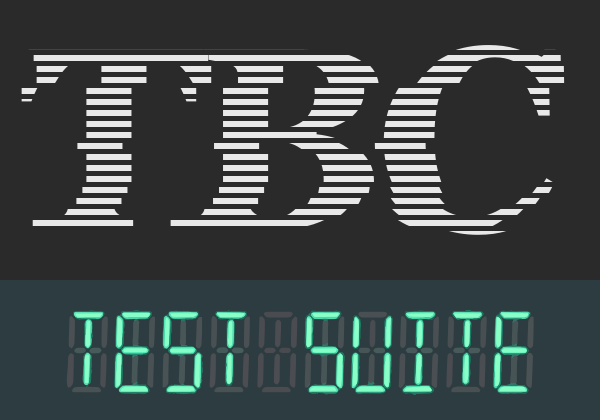
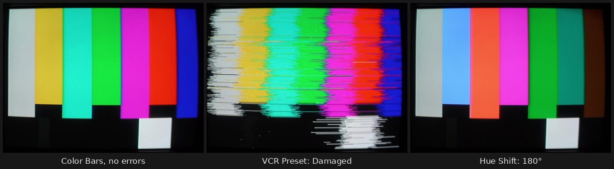
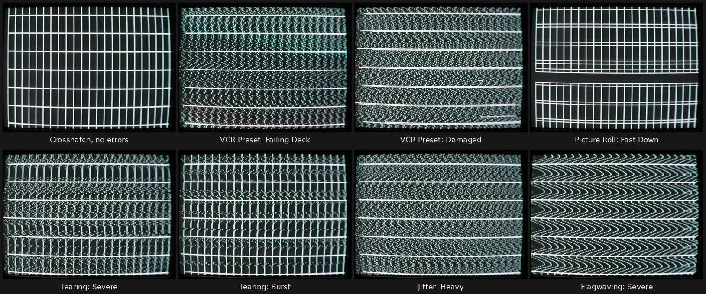
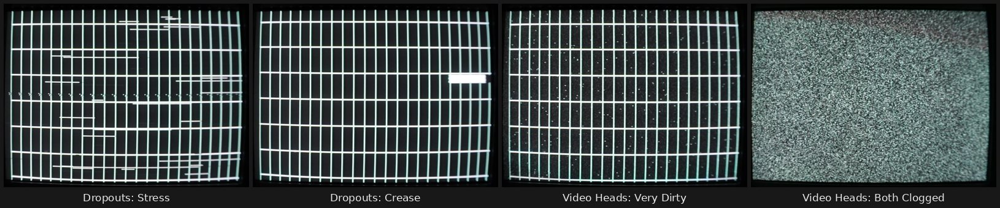
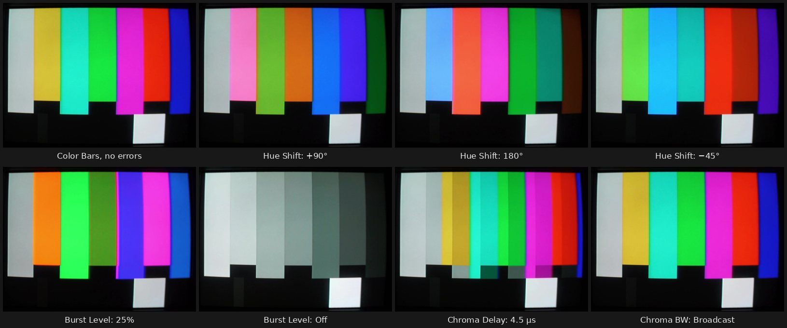

<p align="center"></p>

# TBC Test Suite

A [MiSTer FPGA](https://mister-devel.github.io/MkDocs_MiSTer/) core that generates intentionally malformed NTSC and PAL Y/C (S-Video) signals for testing analog **time base correctors** (TBCs) and **frame synchronizers**.

The core generates test patterns — or plays your own video — and encodes Y/C **with its own NTSC/PAL encoder**, output through the MiSTer's VGA port and an active Y/C adapter (the composite/S-Video adapters made for [MikeS11's Y/C output](https://ultimatemister.com/product/mikes11-active-composite-svideo/)). Because the encoder is in-core, errors can be injected at every level: sync timing (roll, tearing, jitter, flagwaving, skew, wow/flutter, head switch), RF-style defects (dropouts with optional dropout compensation, dirty and clogged video heads), and color encoding itself (hue/burst phase, burst level, subcarrier frequency, chroma delay, chroma noise, chroma bandwidth). Errors combine freely, are deterministic per PRNG seed, and HDMI simultaneously shows a clean reference view untouched by any of them.

<p align="center"></p>
<p align="center"><sub>All photos in this README are of a Pelco PMCS15A CRT monitor fed by the core over S-Video, perspective-corrected from a camera.</sub></p>

## Hardware Requirements

- MiSTer FPGA with a VGA port: a **MiSTer Pi** (built-in VGA port; the tested setup), or a **DE10-Nano** with an analog IO board (e.g., MiSTer A/V Pro) — the DE10-Nano alone has HDMI only
- An active Y/C (composite/S-Video) adapter on the VGA port, of the kind made for MikeS11's Y/C cores (e.g. [this one](https://ultimatemister.com/product/mikes11-active-composite-svideo/)). Tested with a generic active adapter in a 3D-printed case sold on eBay; passive Y/C cables are untested
- USB gamepad or keyboard

## Test Options Guide

Everything is configured from the OSD (**F12** or the controller's OSD button). While the OSD is open, **all errors pause** and the core switches to **progressive timing** (constant field length, so menu text sits rock-stable on CRTs) — closing the OSD arms the configured errors and restores the configured interlace. The menu has four pages plus a video loader:

### Page 1 — Test Pattern

| Pattern | What it's for |
|---------|---------------|
| Logo | The project ident (assets/logo.svg rendered into a 16-color ROM) — the default landing screen. Scanline-striped "TBC" with tear offsets baked into the art, VFD-phosphor "TEST SUITE" panel. Regenerate with `tools/make_logo_rom.py` (the result varies slightly with the librsvg version, so only regenerate when the logo changes) |
| Color Bars | SMPTE bars with reverse-bar and PLUGE sections. The general-purpose reference: hue/saturation on a vectorscope, plus enough structure to see every timing error clearly |
| Crosshatch | White grid — geometry, linearity, convergence; skew and flagwave bend its lines visibly |
| Grayscale | Black→white ramp — luma linearity, quantization, clamp behavior |
| Multiburst | Frequency packets up to ~7 MHz — luma bandwidth of the chain; the top packet is beyond Y/C bandwidth and should render gray |
| Solid Color | Flat full-field color — the sync-separator worst case (no picture structure to hide behind) and chroma demodulator single-axis tests. A **Color** row appears below the pattern selector (White, Yellow, Cyan, Green, Magenta, Red, Blue, Black) along with the shared **Level** row — 75% red is the classic red-field noise/purity signal; 100% is the max-chroma stress. Full-field White is the classic "does anything roll?" stress; Black is the minimal-energy sync-only signal |
| Checker | High-contrast alternating blocks — transient/ringing behavior |
| PLUGE | Black-level setup reference (sub-black, +4 IRE, black, white patches) |
| Convergence | Dot grid — CRT geometry and misconvergence |
| Motion | Animated (inspired by ffmpeg's `testsrc2`): color-bar background, scrolling diagonal band, bouncing box, **field-counter progress bar** and a **~1 Hz blinker** (0.53 s on / 0.53 s off). Dropped, repeated, or reordered fields — the frame-synchronizer failure modes — show up as bar stutters and irregular blinks that no static pattern can reveal. All elements stay inside the CRT-safe area |
| Custom Video | Your own footage as the error source (see **Custom Video Source** below) |
| Analysis | **Machine-readable measurement pattern** for `tools/tbc_analyze.py`: registration border, per-field binary ID barcode, jitter-ruler verticals, 75% color strip. Capture the DUT's output while displaying this pattern and the script reports dropped/repeated/blended fields, residual per-line jitter statistics, and hue/saturation error — the quantitative core of DUT comparisons |
| Mod Staircase | **Waveform-monitor signal** (Tek-style): 5 luma steps (0–80 IRE) with constant 40 IRE p-p chroma at burst phase on every step — measures **differential gain/phase** and luminance linearity through a DUT. Looks like tinted gray bands on a picture monitor; speaks on a WFM/vectorscope |
| Mod Ramp | Same measurement as Mod Staircase with a continuous 0–100 IRE ramp — finer-grained DG/DP |
| Pulse & Bar | **WFM signal**: 100 IRE bar with raised-cosine edges (line tilt / K-factor), 2T sine-squared pulse (transient response/ringing), and 12.5T chroma-modulated pulse — the standard method for measuring **chroma-to-luma delay and gain** through a DUT. Pairs with the Chroma Delay error: inject a known delay, measure what survives correction |
| Window | Centered 100 IRE box on black — **DC restoration/clamp and field-tilt test** (shading above/below the box exposes a bad clamp). A **Window: Static/Bounce** row appears when selected; Bounce inverts the whole picture every ~1 s (APL slams ~11%↔~89% with the box as a constant reference) — the classic proc-amp/TBC AGC and clamp recovery stress |
| Mandelbrot | A **live Mandelbrot zoom computed in the FPGA** — no file to load: an exponential zoom into the Misiurewicz point M23,2 (−0.1011 + 0.9563i — self-similar boundary detail at every depth; ~2× every 3 s down to ~8000×, then it starts over) in a cycling blue–white–orange palette, 360 px per line, every field drawing its own lines (true interlace). Dense high-frequency detail and saturated colors in motion: busy real-world-like content for comb filters, chroma handling and TBC behavior, with every error applied. It restarts with each error run, so a seed replays the same frames |

**Level** switches Color Bars, Motion's background, and Solid Color between 75% (broadcast practice — a 75% red field is the classic noise/purity signal) and 100% (maximum chroma amplitude — harder on chroma AGC). The row appears only while one of those patterns is selected.

**Load Video** appears on this page while Pattern is Custom Video — it opens the file browser for `.bin` clips (see **Custom Video Source** below).

**CRT overscan note:** consumer CRTs hide ~5-10% of the picture behind the bezel. Built-in patterns keep critical elements inside the safe area; **Advanced → V Position** shifts the whole raster down up to 4 lines for extra headroom, and the video converters have a `safe` letterbox mode.

### Page 2 — Timing Errors

These distort *when* things happen — sync timing, line length, field length — which is precisely what a TBC exists to fix. All of them can be combined, and all are deterministic per PRNG seed.

| Error | What it simulates | What to expect / what a good TBC should do |
|-------|-------------------|---------------------------------------------|
| **VCR Preset** | Whole classes of tape in one click, tuned to what real decks do: **Good VHS** (healthy SP deck: subtle head switch, flutter, faint jitter), **Worn VHS** (typical head switch, subtle flagwave, rare dropouts), **EP Rental** (adds mild tearing, bottom-heavy skew, more dropouts), **Failing Deck** (a deck with a bad drum servo and dirty heads: moderate tearing, typical wow and jitter), **Damaged** (everything strong, vertical drift, dirty heads, raw dropouts). VHS line timing comes from the spinning head drum, not the tape speed, so a working deck shows almost no wow — Wow and real tearing only appear from Failing Deck up. Every working deck has a dropout compensator, so all presets but Damaged turn **Dropout Comp** on | Selecting a preset **writes its values into the rows below** — the menu always shows exactly what runs. Tweak any row afterward and the preset drops back to **Off (Manual)** automatically (your mix is custom now — the label never lies); the other rows keep their values as a starting point. Cycling the preset to "Off (Manual)" yourself resets the rows to Off |
| **Picture Roll** | Continuous vsync phase rotation — the sync point slides through the field (Slow ≈ one revolution per 4.4 s, Fast ≈ 0.9 s), so the picture rolls through the screen even on a monitor that stays locked. **Drift** wobbles ±8 lines instead: a vertical hold sitting on the edge | The classic lost-V-hold look. A TBC/frame synchronizer must chase the moving vertical interval; whether it re-centers, free-runs, or drops to black is a strong behavioral discriminator |
| **Tearing** | Per-line horizontal sync displacement (head-switch noise, damaged control track): random lines arrive early/late by µs | The classic VCR look. Mild ≈ real tape; **Severe (±9 µs on ~16% of lines) exceeds anything real** — a torture test; Burst displaces runs of consecutive lines |
| **Jitter** | White per-line timebase jitter: *every* line lands a random amount early/late (uniform; Faint ≈ 0.04 µs RMS — a healthy deck, Light ≈ 0.16, Typical ≈ 0.32, Heavy ≈ 0.65) | The textbook VCR impairment and **the fundamental line-TBC spec**: measure input-vs-output residual RMS with the Analysis pattern's rulers for a single headline attenuation number per device. Seeded and reproducible |
| **Flagwaving** | Sinusoidal line-length modulation over the field (tape tension error); the ripple crawls vertically (~2 s per cycle, Fast ~0.9 s, Slow ~4 s) like a waving flag | Wavy verticals, worst at the top on real tape. Severe kills CRT color lock — a TBC that rides it out and re-times should restore both geometry and color |
| **Skew Error** | Per-line displacement by position (drum speed / tape tension geometry). **Top Heavy**: the tension hook after the head switch — the top of the picture starts ~1.1 µs early and curves into place by line 80. **Bottom Heavy**: the mirror, curling ~1.1 µs late over the bottom third. **Moderate / Severe**: linear slants across the whole field (±1.1 / ±4.6 µs). The heavy modes' jumps back happen inside vertical blanking | A CRT's horizontal AFC *masks* slow skew almost entirely — but a fixed-timebase device (TBC, capture card) sees the full slant. Instructive A/B between CRT and HDMI raw view |
| **Wow** | Slow speed oscillation: Gentle 1.5 Hz at 0.05% (a drum servo hunting slightly), Slow 0.5 Hz / Typical 1.5 Hz at 0.44%, Deep 0.5 Hz at 0.9%. Typical and up are a failing transport, not normal tape | The speed error *integrates* into many microseconds of absolute timebase drift — this exercises a TBC's correction window and servo tracking, not just per-line jitter. Deep wow can exceed line-TBC windows entirely |
| **Flutter** | Fast transport speed jitter: Typical 10 Hz / Fast 30 Hz at ~0.1% | The distinct fast mechanism (motor cogging, guide rattle) — independent of Wow, and the two stack, so "deep wow + fast flutter" is expressible like a real worn transport |
| **Dropouts** | Tape defects (a spot of missing or lifted oxide) — RF envelope loss: a bright noise streak with no color that fades in over ~0.3 µs and leaves a short dark tail as the RF returns. Lengths are short-weighted like real tape (half under 2 µs, 7/8 under 9 µs, rarely up to ~35 µs); Light ≈ 1/s (a worn tape), Moderate ≈ 10/s, Heavy ≈ 100/s (badly damaged tape). **Stress** goes beyond real tape for stress testing: ≈ 1000/s, with every streak one length-octave longer (2–35 µs, averaging ~8 µs). The longest run straight through hsync and burst | From Y/C alone a dropout is indistinguishable from picture content — real dropout compensation needs the VTR's RF envelope flag (the DOC connection on rackmount TBCs). This tests whether a device conceals at all, and whether its sync regeneration survives streaks that eat sync. **Crease** parks a stationary defect zone that streaks the same spot for ~0.8–1.6 s, like a physical tape crease |
| **Dropout Comp** | The deck's own dropout compensator: each dropout is filled with the same stretch of the line above from a fixed 1H delay line (63.56 µs NTSC / 64 µs PAL, like a real deck's glass delay line — not locked to sync, so timebase errors misalign the patch). Long dropouts keep repeating the last good line. Luma only: the color still drops out | What a TBC sees from a working deck: the dropout is mostly hidden, sync stays intact, and only a brief color loss and a slightly wrong patch remain. On: what real decks output. Off: a deck with no (or a failed) compensator |
| **Head Switch** | The helical-scan head handoff: a horizontal phase step a few lines above the bottom of the picture (lines 233+), decaying through blanking into the top of the next field (servo pull-in tau ≈ 32 lines) | **Where to look: the TOP of the picture** — vertical lines hook sideways over the first ~50 visible lines and straighten as the servo pulls in (classic VHS flagging). The step lines themselves sit in the *bottom overscan*, hidden on consumer CRTs exactly like a real VHS noise bar. Use Crosshatch (full-height verticals); the Logo pattern's blank top/bottom shows nothing. Unstable re-rolls the step per field → the hook wobbles |
| **Video Heads** | The deck's two video heads, which read alternate fields (each head's span runs from the head switch at line 233 through vsync to line 232 of the next field). **Dirty**: continuous snow and many tiny white specks, one head worse than the other, so the noise flickers at the field rate. **Very Dirty**: one head heavily snowed, softened, and with its color dropped by the deck's color killer. **One Clogged**: every other field is pure snow with **no sync at all**. **Both Clogged**: snow and no sync on every field — a loss-of-signal test | A different defect from Dropouts: a steady state of the deck, not brief tape spots. Snow is picture content, so no TBC removes it — the tests are sync. One Clogged asks what the DUT does with a field that has no sync: free-run, repeat the good field, or drop out; Both Clogged shows its loss-of-signal behavior (blue/black screen, frozen frame, or passing snow) |
| **Sweep** | Failure-threshold ramp: the selected error (Wow Depth / Tear Amp / Flagwave Amp / Jitter RMS) climbs continuously from zero to beyond-severe over ~60 s and loops | **This is how you put a number on a device.** A severity gauge (bar + 25% ticks + machine-readable level barcode) is drawn into the picture; the clean-HDMI view shows the same gauge untouched. Watch the DUT output and read the gauge at the moment it breaks: that level is the device's correction threshold. Level freezes while the OSD is open |

**On a CRT** (Crosshatch pattern):

<p align="center"></p>
<p align="center">  <br><sub>In motion: Picture Roll: Slow Down, Flagwaving: Severe, and Wow: Deep (the picture sways sideways)</sub></p>
<p align="center"></p>

Slow errors (Skew, Wow) show only mildly on a CRT, whose sync circuits follow them; a TBC or capture device sees them in full.

### Page 3 — Encoding Errors

These distort *how color is encoded* — errors a signal generator can only produce with its own encoder.

| Option | What it simulates | What to expect |
|--------|-------------------|----------------|
| **Encoder** | Custom (ours, with error hooks) vs **Framework Clone** (an in-core copy of MiSTer's `yc_out`) | A/B reference: the clone proves any suspicious behavior is inherent to the encoding, not our encoder |
| **Hue Shift** | Burst phase offset: fixed steps or **Drift** (a full rotation every ~4 s) | Receivers lock hue to burst, so shifted burst rotates every color; 180° swaps to complements. On **PAL** the same error largely cancels into saturation change — PAL's design premise, demonstrable here |
| **Burst Level** | Weak/absent burst, plus **Flicker** (per-line random 100/50/25% amplitude) | Real decoder pathology observed on our reference CRT: 50% shifts decoded hue (phase-detector operating point), 25% *over-saturates* (chroma AGC compensating), Off trips the color killer to B&W. Flicker exercises the chroma AGC's *dynamics* — our CRT shows saturation pumping and washes as its ACC chases the changes |
| **Subcarrier** | Subcarrier frequency error (±250 Hz / ±1 kHz / +5 kHz) or ±1 kHz sinusoidal **Drift** over ~5 s — the aging-crystal / heterodyne color-under pathology. Burst and picture chroma shift together (shared oscillator, correct physics) | Two regimes: inside the decoder's burst-PLL pull-in range, color locks but phase accumulates after each line's burst → **left-to-right hue gradient** (~23°/kHz); beyond pull-in, color unlocks (B&W or rolling rainbow). Step the offset to *measure a DUT's pull-in range* — our reference CRT locks at 250 Hz (gradient visible) and drops color by 1 kHz |
| **Chroma Delay** | Y/C misalignment up to 4.5 µs — heavy color streaking | Color visibly displaced right of luma; gray leading edges where chroma hasn't "arrived". The burst intentionally stays on time (delaying the timing reference would just trip the color killer) |
| **Chroma Noise** | Per-line random burst phase (worn head) | Line-to-line hue flicker; Severe (±45°) shows rainbow mottling — brutal for comb filters |
| **Chroma BW** | Sharp = unfiltered color transitions (synthetic worst case: colored seams at bar edges from decoder ringing/cross-color); Broadcast = ~1.6 MHz pre-modulation low-pass like a real encoder (smooth, ring-free, standards-correct) | Also a comb-filter/TBC chroma-processing discriminator in its own right |

**On a CRT** (Color Bars pattern):

<p align="center"></p>

### Page 4 — Advanced

| Option | Purpose |
|--------|---------|
| **Seed Hi / Seed Lo** | 8-bit PRNG seed as two hex digits, feeding Tearing, Jitter, Dropouts, Video Heads, Head Switch (Unstable), Burst Level (Flicker), and Chroma Noise. The sequence restarts from the seed **every time the OSD closes** — errors start at the next frame boundary (field 1, line 1, within ~33 ms of closing), with every drift and wave (Flagwaving, Hue/Subcarrier Drift, Roll Drift, wow/flutter) restarting there too — so every run with the same seed and settings replays the identical error timeline, line for line, whenever the OSD is closed. Record it with results |
| **Standard** | **NTSC** (525/59.94, 3.579545 MHz) or **PAL** (625/50, 4.43361875 MHz with V-switch and swinging burst). Every timing and encoding error works in both |
| **Output** | **S-Video** (default): luma on Y, modulated chroma on C. Adapters with a summing network (e.g. the MikeS11-style active adapter) already produce full-amplitude composite on their RCA jack in this mode — **use that** to feed a TBC's composite input and exercise its notch/comb Y/C separation. **Composite**: Y and C summed digitally at half scale onto the Y channel, C idles (the framework's `vga_mode=cvbs` convention; half scale re-centers blanking at code 64 so the burst's below-blanking excursion survives the unsigned DAC). For passive/Y-only cabling with no summing adapter, or when a bit-exact known chroma-to-luma ratio is wanted as a measurement reference — otherwise S-Video + the adapter RCA is the better composite. Applies to the Custom encoder only; the Framework Clone always outputs S-Video |
| **VBI Captions** | Inserts a spec-timed EIA-608 waveform on line 21 of field 1 carrying a valid pop-on caption that spells **"TBC TEST"** (redrawn every ~2 s). This is the VBI transparency test: a TBC or frame synchronizer that regenerates blanking strips it. Pass = turning on the CC decoder downstream of the DUT shows the caption; fail = no caption. NTSC + Interlace On only |
| **Pulse Cross** | Emulates a pro monitor's pulse-cross mode **at the source**: the sync pulses are relocated ~half a line and ~half a field away from the picture, so *any* monitor displays the blanking intervals as a centered cross. **Enhanced** (recommended) is the readable view: a relocated burst keeps color alive, a ~25 IRE luma lift makes blanking read gray (burst shows as a colored stripe, caption waveform visible), and the signal's true sync positions are painted at black. Under picture roll Enhanced shows **two** horizontal bands — correct, not a bug: the thin band locked mid-screen is the painted sync marker (the display locks to sync, so sync by definition cannot roll), and the fat rolling band is the vertical blanking interval, which travels with the picture. Source-side roll works by rotating the vsync pulse itself while blanking stays with the content, so sync and blanking genuinely part company in the signal — the cross is faithfully revealing that. **Raw** = the untouched signal, nothing synthetic: the cross is the real blanking band and rolls/deforms with the content — only one band under roll, since nothing marks the sync position (the electrical pulses ride at the screen edge, hidden in the retrace); B&W is inherent — the decoder's burst gate follows the relocated sync and finds no burst. Dropouts streak through the cross in both modes (authentic; Enhanced masks them only over the relocated sync so the view keeps lock). Shows this core's own signal — inspecting a DUT's *output* blanking still needs a real pulse-cross monitor. Pauses while the OSD is open |
| **Interlace** | On = standard interlace: 262.5-line (NTSC) / 312.5-line (PAL) fields with the half-line vsync offset, so the fields' lines interleave; Off = fixed 262/312-line progressive fields |
| **Video Level** | Clamps RGB to 255/235/192/128 before encoding — headroom/level-handling tests |
| **HDMI View** | **Clean** (default): HDMI shows a framebuffer of the clean pattern, rendered by position so it is *immune to every injected error* — a pristine reference even while the analog output is destroyed. **Encoded Raw**: HDMI shows the raw Y/C channels (luma-as-green false color) for signal debugging |
| **V Position** | Shifts the picture down on the CRT (Default / 2 / 4 lines) by moving vsync earlier in blanking — counteracts top overscan, analog-only |

**Channel Banner** (main menu) stamps a lower-third "SUBSCRIBE / ARCLIGHT AUTOMATA" ident with a play button into the video itself — it rides through the DUT and into captured footage, and every timing/encoding error applies to it like any other content. Suppressed on the Analysis pattern and the waveform-monitor patterns (Mod Staircase, Mod Ramp, Pulse & Bar, Window) so measured geometry and levels stay intact.

**Factory Defaults** (main menu) resets every option on every page to its default in one press — pattern, all errors, encoding, and Advanced settings.

**Saving settings:** the core starts from defaults on every load unless you save. From the main menu press **Right** to reach the MiSTer System page and choose **Save settings** — the current options (every page, including the seed) are written to `config/TBC_TEST_SUITE.CFG` and restored on the next load. To go back to defaults permanently, press Factory Defaults and save again (or delete that file).

### Custom Video Source

Any video file (`.mp4`, `.mkv`, `.avi`, `.mov`, `.mpg`, `.webm`, `.m4v`) can replace the test patterns as the error source — no PC required:

1. Copy the video file to `games/TBC_TEST_SUITE/` on the SD card.
2. Run **`tbc_video_convert`** from the MiSTer **Scripts** menu (install: copy `tools/tbc_video_convert.sh` to `/media/fat/Scripts/`; it downloads a static ffmpeg to `/media/fat/linux/` on first run). Each video becomes a `.bin` next to it — first 10 s, letterboxed into the CRT-safe area, converted on the MiSTer's ARM at roughly ⅔ realtime. *(The Scripts menu lives in the MiSTer **main menu** — open the OSD there and flip to the "System Settings" page. It does not appear inside a core's OSD.)*
3. In the core: **Pattern → Custom Video**, then the **Load Video** row appears — pick the `.bin`.

The clip (up to ~12 s / 248 MB) loops from DDR as 480i, and every timing error, encoding error, and VCR preset stacks on top of it — while the clean-HDMI view keeps showing the untouched clip for reference. (`tools/convert_video.sh` remains for converting on a PC instead; pass `safe` as the 4th argument for the same letterboxing.)

**`.bin` vs `.sbin`:** a `.bin` is a short clip loaded *whole into DDR* through the OSD's Load Video row (≤ ~12 s; loops from RAM); an `.sbin` is the *streaming* format — fed continuously from the SD card by the `tbc_stream` daemon on the ARM, unlimited length. The Load Video browser deliberately lists only `.bin`: an `.sbin` can't be played through the DDR-load path (wrong format, and only the ARM can pace it from SD), so streaming always starts from the Scripts menu / ssh side.

**Auto-convert watcher:** install `tools/tbc_autoconvert.sh` to `/media/fat/Scripts/`, then either run it from the Scripts menu to toggle it for the session (opt-in), or run **`tbc_autoconvert.sh install`** once (ssh or console) to make it the **default**: it starts immediately and adds itself to `/media/fat/linux/user-startup.sh` so it runs from every boot — `tbc_autoconvert.sh uninstall` reverts to opt-in. From then on, any video you copy into `games/TBC_TEST_SUITE/` (scp/SMB/USB) is converted automatically, so the `.bin` is already waiting in the Load Video browser. It waits for in-flight copies to finish, writes atomically (the browser never sees a partial file), marks broken files with `<name>.failed` instead of retrying them forever, and logs to `/tmp/tbc_autoconvert.log`; `start`/`stop`/`status` work over ssh. Set `STREAM=1` to produce full-length `.sbin` files instead of 10 s clips. Idle cost is negligible (a directory check every 10 s; ffmpeg runs only when files change) — the real cost of leaving it on is **disk**: see the size warning below.

**Mind the output sizes — raw video is enormous.** A `.bin` clip is ~21 MB *per second* (~208 MB for the default 10 s); a full-length streaming `.sbin` is ~10.4 MB per second — about **3 GB for 5 minutes, ~19 GB for a half-hour tape**. Budget SD card space accordingly, and note that a FAT32-formatted card caps single files at 4 GB (exFAT, the usual MiSTer format, has no such limit).

**Longer videos (streaming):** clips of unlimited length can be streamed from the SD card instead of loaded into DDR. Convert with `STREAM=1 tbc_video_convert.sh` (produces a full-length half-width `.sbin` — 10.4 MB/s against the ~23 MB/s the SD interface sustains), then run **`tbc_stream`** from the Scripts menu (or `tbc_stream.sh <file>` / `tbc_stream.sh stop` via ssh) and select the Custom Video pattern. A small daemon paces frames into a DDR ring buffer with closed-loop feedback from the core, so playback runs indefinitely and loops; install `tools/tbc_streamd` to `/media/fat/linux/` alongside the script. Switching to another pattern and back resumes the stream where it was; loading a clip through Load Video (or starting another stream) stops the running daemon, since they share the same DDR region.

## What Should a TBC Fix?

The hypothesis sheet for any device test. The governing principle: **a TBC corrects deviations of the signal from its own embedded references (sync and burst); it cannot correct errors that are indistinguishable from legitimate picture content or calibration.**

Internally, a typical rackmount TBC digitizes the input locked to the *input's* sync and burst, decodes chroma to component using the input burst as phase/gain reference, buffers lines or frames, then reads out with clean uniform timing and **re-encodes with freshly generated sync and burst**. Two classes behave differently: **line TBCs** (a few-line FIFO, output timing servo'd to the input) and **full-frame TBCs / frame synchronizers** (whole-frame store, output timing independent, absorbing drift by dropping/repeating fields).

### Timing errors

| Error | Expected outcome | Why |
|---|---|---|
| **Tearing** | Fully corrected (Mild/Moderate); Severe probes the sync separator | Per-line H re-timing is the core job; at ±9 µs jumps the real question is whether the input sync detector still finds the pulse — look for individual mis-timed lines |
| **Flagwaving** | Fully corrected | The canonical line-TBC demo: smooth per-line error, deep inside any correction window |
| **Skew** | Fully corrected | Same mechanism, gentler |
| **Head Switch** | Fully corrected — the signature VHS fix | Before/after of the top hook on Crosshatch is the cleanest single demo. Caveat: the step crosses the vertical interval, where some designs relax correction |
| **Jitter** | Fully corrected — **the headline spec** | White per-line displacement is precisely what a line TBC exists to remove; input-vs-output residual RMS (Analysis pattern) is the single most comparable number between devices |
| **Flutter** | Fully corrected | 10–30 Hz integrates to at most ~±13 µs of timebase displacement — a fraction of a line |
| **Wow** | **The class discriminator** | 0.5–1.5 Hz deviation integrates to large timebase drift — about ±60 µs (Gentle, about one line), ±0.5 ms (Typical) up to ±2.8 ms (Deep), i.e. roughly 7 to 40+ lines, beyond any line FIFO. Line TBC: servo-tracks the slow wander, corrects fine jitter, may hop when re-centering. Frame sync: absorbs it fully but must drop/repeat fields — which the Motion and Analysis patterns count |
| **Picture Roll** | Not correctable by sync processing — but the DUT's *response policy* is the measurement | Two distinct "rolls" exist. Real-tape roll is display-side: degraded vsync the monitor can't lock to, with content-to-sync intact — a TBC **fixes that** by regenerating sync (tested here via Dropouts eating the sync region). This row synthesizes the other kind: a clean vsync train whose spacing is off from the content's field length (e.g. every 261 lines against content at 262 for Slow Down) — the roll is *in the content-to-sync relationship*, so a frame sync's buffer (write-addressed from input vsync) stabilizes the raster while the picture rolls inside it. Watch the DUT's vertical window/coast policy: smooth pass-through, *stepped* roll (coast-then-snap — partial de facto correction), or freeze/black on loss-of-lock — each is a sync-engine fingerprint |
| **Dropouts** | Sync regeneration corrected; content noise passes through | A good TBC coasts its flywheel through streaks that eat hsync/burst and outputs clean regenerated sync — genuinely testable. The sparkle itself is indistinguishable from picture content; real concealment needs the VTR's RF envelope flag (the DOC input), which no baseband signal can provide. A DUT that conceals anyway is doing content-based guessing — worth calling out |
| **Video Heads** | Snow passes through; the sync handling is the test | One Clogged: a line TBC usually free-runs through the sync-less fields (picture alternates with snow); a frame sync may repeat the good field (a frozen-looking but steady picture) or blank. Both Clogged: the loss-of-signal behavior — blue/black screen, last frame frozen, or snow passed through |

### Encoding errors

Key mechanism: the TBC **regenerates burst on output no matter what**, so the output becomes standards-legal — but the decoder's *interpretation* of the input error gets baked into the picture.

| Error | Expected outcome | Why |
|---|---|---|
| **Hue Shift** | Passed through | The decoder trusts the input burst as hue reference and faithfully re-encodes the rotated colors. Indistinguishable from an intentional grade — that's why proc amps have hue knobs |
| **Burst Level** | Signal legalized; picture error baked in | Output burst returns at 100% (a real correction of the *signal*), but the input chroma AGC's reading of the weak burst lands in the picture. Whether 50%/25% shifts hue or saturation on a given DUT reveals its AGC/PLL design. Burst Off → expect clean B&W out |
| **Chroma Delay** | Passed through (trim knob on broadcast-grade units) | Decoded as spatially displaced color — indistinguishable from content |
| **Chroma Noise** | **Partially cleaned — a great discriminator** | A slow burst PLL (averaging phase across lines) filters per-line hue flicker as a side effect; a fast per-line burst gate reproduces it. This row measures the DUT's burst-loop bandwidth |
| **Subcarrier** | Signal always legalized; picture outcome measures the chroma loop | The TBC re-encodes on its own crystal, so the output subcarrier is exactly on-frequency regardless. Inside its pull-in range: a continuously-tracking burst-locked VCO stays coherent across the line (gradient **corrected**), while a per-line sample-and-hold reference bakes the hue gradient into the picture (passed through). Beyond pull-in: color killer. Step the offset to measure the DUT's pull-in range |
| **Chroma BW (Sharp)** | Effectively corrected | Any decoder's chroma bandpass discards the out-of-band sideband energy |
| **VBI Captions** | The transparency coin-flip | Line TBCs that re-time the VBI usually pass CC; frame-class devices that regenerate blanking usually strip it |

### The theoretical dividing line

Anything expressible as "the signal deviates from the standard *relative to its own sync and burst*" is correctable in principle and mostly in practice: per-line timing, sync integrity, burst amplitude/presence, out-of-band chroma. Anything where the error lives in the relationship between references and content — hue rotation, saturation, Y/C registration, picture-vs-sync position (roll), dropout pixels without an RF flag — is information-theoretically unrecoverable without a second reference the signal doesn't carry (a calibration standard, human intent, or the head-amp RF envelope). Modern content-aware processing can *guess* at the second category; catching a DUT doing so is itself a result.

## Measurement Methodology & Limitations

This core is designed for *comparative, reproducible* characterization of TBCs and frame synchronizers. When publishing results based on it, the following disclosures apply:

- **Baseband Y/C generation.** All errors are synthesized at baseband on the demodulated signal. RF-domain phenomena are *modeled*, not replicated: dropouts and head snow reproduce the demodulated result of RF loss (bright noise, dead chroma), not true FM noise character, and there is no RF envelope output — TBCs with dedicated DOC/RF inputs can only be tested for their video-path behavior, not their RF-flagged concealment.
- **Fixed sync amplitude.** Composite sync is inserted by the IO board's sync-on-green hardware at a fixed level; sync *amplitude* stress tests (weak/noisy sync tips) are not possible. Sync *timing* stress is fully covered.
- **Interlace structure.** Interlaced output is textbook: 262.5-line (NTSC) / 312.5-line (PAL) fields with the half-line vsync offset, and the core generates the full composite sync itself - NTSC 6 equalizing + 6 serrated broad + 6 equalizing pulses at half-line spacing (PAL 5 + 5 + 5), burst blanked through the vertical interval.
- **Chroma bandwidth is selectable** (Sharp = full-bandwidth synthetic transitions, Broadcast = standards-like 1.6 MHz pre-filtering). State which was used; Broadcast is the realistic default for device comparisons.
- **Reproducibility.** All stochastic errors derive from a seedable PRNG: the same seed and settings produce the *same error timeline*, so different devices can be fed identical stimulus. Record seed + settings with results.
- **Capture chain.** Quantitative evaluation captures the device-under-test's output with a digitizer. Use the *same* capture device for every DUT in a comparison: its own input stage cancels out of relative results. CRT observations are qualitative complements, not measurements.

**Quantitative workflow:** select the **Analysis** pattern, configure the error(s) under test, run the chain `MiSTer → DUT → capture device`, record ~30 s, then `tools/tbc_analyze.py capture.mkv`. The report gives field-sequence accounting (drops/repeats/blends and their cadence — the frame synchronizer's re-timing policy), residual per-line jitter statistics in pattern pixels (what the TBC failed to correct), and color error under the configured stress. A no-error run through the same chain establishes the chain's own noise floor; subtract mentally or in post. The whole capture is analyzed (`--max-frames N` to limit it); geometry is located on every frame, so a black lead-in or a picture shift doesn't spoil the result, and frames without the pattern are counted as `no_pattern`. For woven captures the field order is detected from the barcode and reported (`order`); force it with `--order top|bottom` if needed.

## Setup

### MiSTer Configuration

Add the following to `MiSTer.ini` on your SD card — the global lines plus a per-core section:

```ini
; global section
composite_sync=1
vga_sog=1

; per-core section (at the end of the file)
[TBC_TEST_SUITE]
vga_mode=rgb
```

`vga_sog=1` is required: the encoder's Y channel carries no sync of its own; the sync-on-green hardware on the IO board sums composite sync into the Y channel. Without it the picture rolls. `vga_mode=rgb` (per-core, so your other cores keep their S-Video setting) bypasses the framework's own Y/C encoder — this core encodes Y/C itself. **No `yc.txt` entries are needed**: the subcarrier is generated inside the core.

### Usage

1. Download `TBC_Test_Suite_<date>.rbf` from this repository's GitHub Releases page (or build it yourself, see [Building from Source](#building-from-source)) and copy it to the MiSTer SD card (e.g. the `_Utility` folder)
2. Launch it from the MiSTer menu; press **F12** (or the controller OSD button) for the menu
3. Configure a pattern (Page 1) and errors (Pages 2–3); the picture stays clean while the OSD is open
4. **Close the OSD** to arm the configured errors on the analog output
5. HDMI keeps showing the clean reference view throughout; press **Button B** on a controller to reopen the OSD

### Signal Routing

```
Core (RGB patterns) → custom yc_encoder (Y/C + encoding errors) → VGA_G/VGA_R → DAC → Active Y/C adapter → S-Video → TBC Under Test
```

The core encodes NTSC/PAL Y/C **itself** (rtl/yc_encoder.sv, a clone of the framework's `yc_out` datapath with error hooks), which enables encoding-level errors the framework can never produce: burst phase (hue shift/drift), burst amplitude (color-killer tests), chroma delay, and per-line chroma phase noise. The burst also tracks injected *timing* errors, so tearing/wow keep realistic color behavior. The core also generates the standard composite sync itself (equalizing and serrated broad pulses, half-line interlace offset); it reaches the adapter via `composite_sync=1` + `vga_sog=1`.

**Framework modifications** (two, both unavoidable): (1) the stock framework forces video to black outside DE, which would erase the color burst from the blanking interval of our self-encoded C channel; (2) its composite-sync combiner builds csync from separate HS/VS and cannot produce equalizing pulses or the half-line interlace offset, so the core generates standard composite sync itself on HS and the combiner's VS input is held low to pass it through. `sys/sys_top.v` carries both as marked changes — captured in `framework-mods.patch` at the repo root for re-application whenever `sys/` is updated from [Template_MiSTer](https://github.com/MiSTer-devel/Template_MiSTer). Everything else follows the template unmodified (the core requires `[TBC_TEST_SUITE] vga_mode=rgb` in `mister.ini`, which the ARM honors per-core). An OSD option (Encoding Errors → Encoder → "Framework Clone") selects an in-core `yc_out` instance for A/B reference.

**HDMI output:** the HDMI scaler displays a DDRAM framebuffer holding the clean RGB pattern (rendered by pattern position, so it is immune to the injected timing errors) — a pristine reference view even while the analog output is being torn apart. Advanced → "HDMI View: Encoded Raw" switches HDMI to the raw Y/C channels (luma-as-green false color) for signal debugging.

## Building from Source

### Prerequisites

This project requires **Intel Quartus Prime Lite Edition 17.0.2** (free, no license needed). Quartus is the only synthesis tool that supports the Cyclone V FPGA used in MiSTer hardware.

### Option A: Docker (Recommended for Linux)

The easiest way to compile on Linux without installing Quartus natively, using the prebuilt `ryanfb/quartus-mister` image (Quartus 17 Lite with Cyclone V support):

```bash
# 1. Install Docker
sudo apt install docker.io
sudo usermod -aG docker $USER
# Log out and back in for group change to take effect

# 2. Compile the core (from this project's directory)
cd /path/to/tbc_test_suite
docker run --rm -v "$(pwd)":/build --entrypoint bash ryanfb/quartus-mister -c \
  'export PATH=/opt/intelFPGA_lite/17.0/quartus/bin:$PATH; cd /build && quartus_sh --flow compile TBC_Test_Suite.qpf'
```

This calls Quartus directly rather than through the image's `quartus_wrapper`: the wrapper starts a login shell whose `/root/.profile` overrides `LD_PRELOAD`, and Quartus then fails to start with `CXXABI_1.3.8 not found`. A full compile takes roughly 5 minutes. The output `.rbf` file will be in `output_files/`.

### Option B: Native Quartus Installation

1. Download Quartus Prime Lite 17.0 (17.0.2 update) for Linux from Intel's [FPGA software download archive](https://www.intel.com/content/www/us/en/collections/products/fpga/software/downloads.html?edition=lite&s=Newest) — pick the 17.0 release, not the newest
   - You need the Quartus base + Cyclone V device support
2. On modern Ubuntu (20.04+), install 32-bit compatibility libraries:
   ```bash
   sudo dpkg --add-architecture i386
   sudo apt update
   sudo apt install libxft2:i386 libxext6:i386 libncurses5:i386
   ```
3. Run the Quartus installer and follow the prompts
4. Open the project:
   ```bash
   quartus TBC_Test_Suite.qpf
   ```
5. Compile: **Processing → Start Compilation** (or `Ctrl+L`)
6. The output `.rbf` file will be in `output_files/`

### Option C: Windows

Download and install [Quartus Prime Lite 17.0.2 for Windows](https://www.intel.com/content/www/us/en/collections/products/fpga/software/downloads.html?edition=lite&s=Newest). Open `TBC_Test_Suite.qpf` and compile.

### The streaming daemon (`tools/tbc_streamd`)

`tools/tbc_streamd` is a prebuilt, statically linked ARM binary for the MiSTer's Linux, built from `tools/tbc_streamd.c`. To rebuild it (any Linux machine with Docker, no toolchain install needed):

```bash
docker run --rm -v "$(pwd)/tools":/w -w /w debian:bookworm sh -c \
  "apt-get update -qq && apt-get install -y -qq gcc-arm-linux-gnueabihf && \
   arm-linux-gnueabihf-gcc -static -O2 -o tbc_streamd tbc_streamd.c && \
   chown $(id -u):$(id -g) tbc_streamd"
```

With Debian bookworm's cross compiler this reproduces the shipped binary byte for byte. Copy it to `/media/fat/linux/` on the MiSTer, next to `tbc_stream.sh`.

## Running the Tests

The `sim/` directory holds 18 simulation tests: Verilator testbenches that run the real RTL modules against reference models, plus C, Python and shell tests for the host and MiSTer-side tools. Run them all from the repo root:

```bash
sudo apt install verilator g++ make python3 python3-numpy ffmpeg   # Ubuntu 24.04: Verilator 5.020
make test
```

This prints PASS/FAIL per test and exits non-zero if any failed; each test's output is in `sim/obj_logs/<test>.log`. A full run takes about 6 minutes, most of it the dropout statistics run (60 s of simulated video). GitHub Actions runs the same command on every push and pull request (`.github/workflows/test.yml`). To run one test, use its name: `make -C sim mandel`. The list, with what each one checks, is at the top of `sim/Makefile`.

The tests do not build the core itself — that needs Quartus (see above).

### Hardware capture helpers

The hardware checks drive the MiSTer's OSD remotely and photograph the result, using two scripts in `tools/`:

- `osd.sh <keys>` sends a key sequence to the OSD through [MiSTer_Batch_Control](https://github.com/pocomane/MiSTer_Batch_Control) (`mbc`) over ssh, then grabs one HDMI frame. The key codes are listed at the top of the script.
- `capture.sh <label>` grabs one HDMI frame and eight frames (~2.7 s) from a camera pointed at a CRT on the analog output. A camera is used instead of a capture card because a capture card's digitizer can quietly correct timing errors.

Both read their settings from environment variables, with defaults for the author's rig:

| Variable | Default | Used by |
|---|---|---|
| `MISTER_HOST` | `mister` (an ssh host alias) | osd.sh |
| `MBC` | `/media/fat/mbc` | osd.sh |
| `HDMI_DEV` | `/dev/video11` | both |
| `CRT_DEV` | `/dev/video10` | capture.sh |
| `CAPTURE_DIR` | `/tmp/tbc_captures` | both |

## Technical Details

### Architecture

The core generates RGB content (patterns or video), then encodes Y/C itself in `rtl/yc_encoder.sv` — a clone of the framework `yc_out` datapath (by Mike Simone) with error hooks added. Y goes out on VGA_G and C on VGA_R; composite sync is added to Y by the IO board's sync-on-green hardware. Timing errors are injected in the timing generator by changing line lengths, line start positions, and the vsync position. The encoder's burst gate follows the generator's (error-shifted) timing, so the burst moves with every injected timing error.

- **Standards**: NTSC (default) and PAL (Advanced → Standard). PAL runs from the same clock via DDS (4.43361875 MHz subcarrier, 64 µs lines - 3665/3666 samples, 5 long in every 11, averaging exactly 15,625 Hz - 312.5-line fields, V-switch and ±135° swinging burst); active geometry stays 724×240 per field, centered.
- **Clock**: 57.272727 MHz (16x NTSC color subcarrier, PLL from 50 MHz)
- **Line timing**: 3640 samples per line (63.556 µs) in NTSC, 910 pixels at 14.318 MHz pixel rate; active video is samples 668–3567 (724 pixels)
- **Field timing**: 262.5 lines per field (interlaced, 59.94 Hz: 263/262 whole lines of picture with the 263-line field's vertical interval starting mid-line), fixed 262 (progressive); PAL 312.5 or 312
- **Vertical sync**: a standard vertical interval inside vertical blanking - NTSC 3 lines of equalizing pulses, 3 of serrated broad pulses (lines 245–247), 3 of equalizing; PAL 2.5 lines of each (broad pulses from line 276); no burst through it. V Position moves it 2 or 4 lines earlier.
  This placement matters: if vsync overlaps active video, bright full-field patterns
  corrupt the sync interval and AC-coupled sync separators lose vertical lock.
- **Subcarrier**: 40-bit phase accumulator; NTSC increment 2^36 = 68719476736 (exactly 16 clocks per cycle), PAL 85115823899. The Subcarrier error adds a signed offset to the increment.

### How Errors Are Injected

Timing errors (all in `rtl/ntsc_timing.sv`, driven by `rtl/error_injector.sv`):

- **Picture Roll**: Rotates the vsync position through the field, a little more each field — field rate stays nominal, picture-to-sync phase slides continuously
- **Tearing / Jitter / Skew / Head Switch**: Per-line horizontal offsets (sparse random, dense random, curved or linear by line, and a decaying step at line 233). The offsets add together; a line that starts N samples late is made by stretching the previous line by N samples
- **Flagwaving**: Modulates line length sinusoidally by line number with a per-field phase advance: `length = 3640 + A*sin(2pi*line/period + phase(t))` — the ripple crawls vertically instead of standing still
- **Wow / Flutter**: Modulate line duration from two independent free-running time-domain oscillators (wow 0.5–1.5 Hz, flutter 10–30 Hz), like tape transport speed error; their contributions sum. The deviation integrates into large absolute timebase drift, exercising a TBC's correction window and servo tracking rather than per-line jitter tolerance

Encoding errors (in `rtl/yc_encoder.sv`): Hue Shift and Chroma Noise rotate only the burst phase; Burst Level scales burst amplitude; Subcarrier offsets the shared DDS; Chroma Delay delays U/V ahead of the modulator (the burst is never delayed), so the color content lags its luma without any hue change; Chroma BW adds a 16-tap low-pass on U/V before modulation.

Dropouts (`rtl/error_dropout.sv`) and video-head condition (`rtl/error_head.sv`) are applied *after* encoding, in `rtl/out_stage.sv`: it splits the encoded signal back into luma and chroma (in Composite using the encoder's luma alone), blends the luma toward the dropout level (or, with Dropout Comp, the line from a fixed 1H delay line one line back), adds head snow, mutes chroma where the defect kills it, and recombines. A clogged head also removes the composite sync for its fields.

Because the subcarrier is free-running, any H-sync timing shift also shifts the burst phase relative to the line — naturally producing the hue errors that real tape playback exhibits.

### Module Architecture

```
TBC_Test_Suite.sv                Top-level emu module, OSD menu, preset/defaults write-back
├── sys/                         MiSTer framework (two marked changes, see framework-mods.patch)
├── rtl/pll/                     PLL: 50 MHz → 57.272727 MHz
├── rtl/ntsc_timing.sv           NTSC/PAL H/V counters, sync, burst window, pulse cross
├── rtl/pattern_gen.sv           15 generated test patterns (RGB) + sweep gauge
│   └── rtl/logo_rom.sv          Logo pattern ROM (logo_rom.mem, logo_palette.svh)
├── rtl/mandel_gen.sv            Mandelbrot pattern: live zoom, 12 iteration engines
├── rtl/error_injector.sv        Error coordination, sweep ramp, PRNG reseeding
│   ├── rtl/error_roll.sv        Vsync rotation (picture roll)
│   ├── rtl/error_tear.sv        Sparse per-line H offsets (tearing)
│   ├── rtl/error_jitter.sv      White per-line H offsets (jitter)
│   ├── rtl/error_flagwave.sv    Line length modulation (flagwaving)
│   ├── rtl/error_skew.sv        Linear H offset by line (skew)
│   ├── rtl/error_wow.sv         Wow + flutter line length modulation
│   └── rtl/error_headswitch.sv  Head-switch phase step + servo pull-in
├── rtl/error_dropout.sv         Dropouts (gate the encoded Y/C)
├── rtl/error_head.sv            Video heads: dirty/clogged head snow, specks, sync removal
├── rtl/out_stage.sv             Dropouts, dropout comp, head condition, pulse-cross aids at the Y/C pins
├── rtl/yc_encoder.sv            Custom NTSC/PAL Y/C encoder with error hooks
├── rtl/vbi_cc.sv                EIA-608 line-21 caption generator
├── rtl/ident_banner.sv          Channel Banner overlay
├── rtl/osd_button.sv            Button B → virtual OSD button (held until the OSD opens)
├── rtl/fb_writer.sv             Clean-HDMI framebuffer writer (DDRAM)
├── rtl/video_loader.sv          OSD file download → DDRAM (Custom Video clips)
├── rtl/video_player.sv          DDRAM → pixels (clips and SD streaming)
├── rtl/ddram_mux.sv             DDRAM arbiter for the four clients above
├── rtl/prng.sv                  Seeded xorshift32 PRNG
└── rtl/sine_lut.sv              256-entry sine table (shared)

tools/
├── tbc_analyze.py               Capture analysis for the Analysis pattern
├── tbc_video_convert.sh         On-MiSTer video converter (.bin / .sbin)
├── tbc_autoconvert.sh           On-MiSTer background auto-convert watcher
├── tbc_stream.sh, tbc_streamd   SD streaming launcher + daemon (tbc_streamd.c is the source)
├── convert_video.sh             PC-side video converter
├── make_logo_rom.py             Regenerates the Logo ROM from assets/logo.svg
└── osd.sh, capture.sh           Dev-rig helpers (remote OSD control, CRT/HDMI capture)

sim/                             Simulation tests (`make test`; list in sim/Makefile)
```

## License

TBC Test Suite is free software, licensed under the [GNU General Public License, version 2](LICENSE) or (at your option) any later version. Each source file carries an `SPDX-License-Identifier: GPL-2.0-or-later` tag.

The MiSTer framework files in `sys/` come from [Template_MiSTer](https://github.com/MiSTer-devel/Template_MiSTer). They are copyright their respective authors and are also licensed GPL-2.0-or-later; the two changes this core makes to `sys/sys_top.v` are listed in `framework-mods.patch`.

The logo (`assets/logo.svg`, also built into the core as the Logo pattern; `assets/logo_text.svg` is the editable original, with "TBC" as live Georgia Bold text instead of outlines) and the CRT photos in `assets/crt/` are part of this project and are covered by the same license. The animations, their source clips and the capture scripts live in [tbc_test_suite_media](https://github.com/ArclightAutomata/tbc_test_suite_media), also GPL-2.0-or-later.

Copyright © 2026 Abe Voelker.
